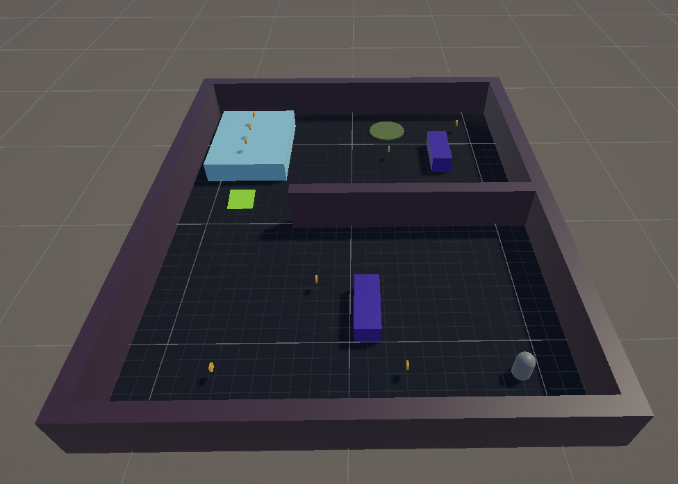
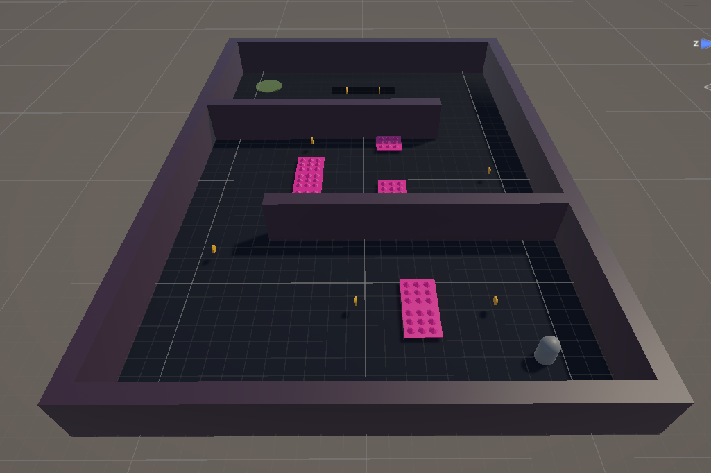
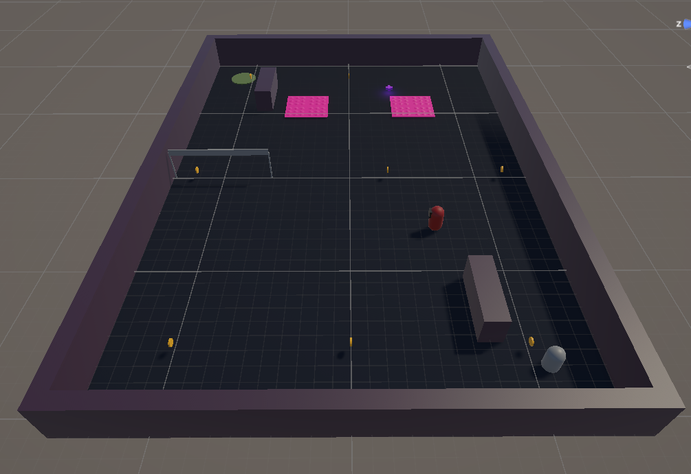
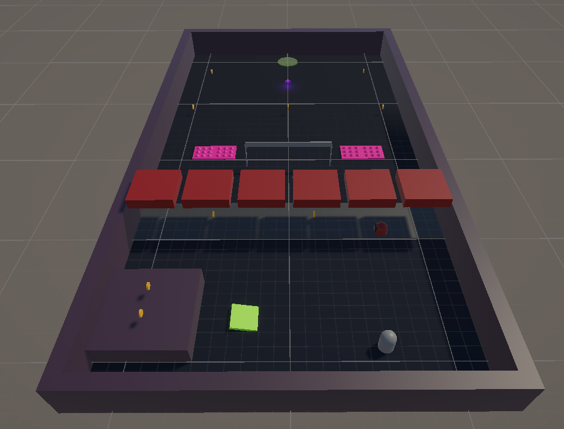
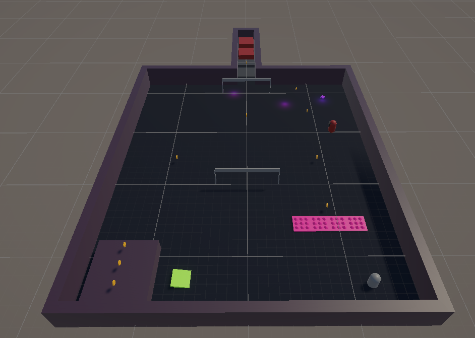

# CS464 Assignment 03 · Muhammad Hamza · BSSE23001

- **Video:** https://drive.google.com/file/d/1m73caQzogv-LlhLUoE03czYL9nBzNtbO/view?usp=sharing
- **Started from:** I have reused most of the scripts and prefabs from my own Lab 06, because it already had the player, hazards, pickups and GameManager I needed. I built the five new levels on top of it. Many of the scripts are here but not used, they are just remained here so as no other script get failed.
- **Controls:** Arrow keys to move, Space to jump
- **To win a level:** Collect the target number of coins (8 / 7 / 7 / 8 / 9 for Levels 1–5), then reach the goal. Losing all lives shows the lose panel.

## Levels

| Level   | Screenshot                                  | New idea                                             | Combined with                                 |
| ------- | ------------------------------------------- | ---------------------------------------------------- | --------------------------------------------- |
| Level01 |  | Coins, goal and bounce pad (nothing hurts)           | Nothing (intro level)                         |
| Level02 |  | Spikes, hearts, pit with optional risky plank detour | Coins, goal, checkpoints (pad removed)        |
| Level03 |  | Patrolling guard that chases and gives up            | Spikes, hearts, coins, checkpoint             |
| Level04 |  | Crusher tiles that warn, then strike                 | Bounce pad, spikes, guard                     |
| Level05 |  | Timed speed power-ups to beat a crusher corridor     | Bounce pad, spikes, crushers, ping-pong guard |

## The numbers

| Number            | Value                       | Why this value                                                                                                                                                                                                     |
| ----------------- | --------------------------- | ------------------------------------------------------------------------------------------------------------------------------------------------------------------------------------------------------------------ |
| Patrol speed      | 4.5 m/s                     | Slightly slower than my run speed, so the guard can be dodged in time.                                                                                                                                             |
| Chase range       | 6 m (give-up 9 m)           | Guard notices only when we are close, but we can grab edge coins safely. The longer give-up range stops it flickering between chase and patrol. Chase speed is 3.5 m/s, balanced by the damping imposed on player. |
| Knockback         | 6, ForceMode.VelocityChange | Throws the player about 2 m away from the hazard in play, enough to clear it without feeling unfair.                                                                                                               |
| I-frames          | 1 s                         | Long enough to get clear after a hit, and means only one heart per second if we stand in a hazard.                                                                                                                 |
| Power-up duration | 5 s (1.6× speed)            | Long enough to sprint through the crusher corridor, but too short to use for the whole level.                                                                                                                      |

## Short answers

**1. Why does a trigger need a Rigidbody on at least one of the two objects?**
Physics Engine only sends trigger events for pairs that include a Rigidbody. Two plain static colliders never move relative to the physics system, so no `OnTriggerEnter` is raised. One Rigidbody is must.

**2. Which ForceMode do your knockback and your Part A force use, and why each?**
Knockback uses `ForceMode.VelocityChange` which is an abrupt change of velocity that ignores mass, so every hit throws the player the same distance. The Part A force (bounce pad launch) uses `ForceMode.Impulse` because for bounce we need a sudden push for the long jump.

**3. What does your code do when a second power-up is picked up while one is running?**
It refreshes: the timer is reset to the full 5 s instead of stacking. The speed multiplier is not applied twice, so the speed stays at 1.6× and returns to the normal value once when the timer ends.

**4. Why can `==` fail as an arrival check, and when does it work?**
Positions are floats and a moving object rarely lands on the exact target value because of rounding and frame-sized steps, so it can overshoot or never match.
